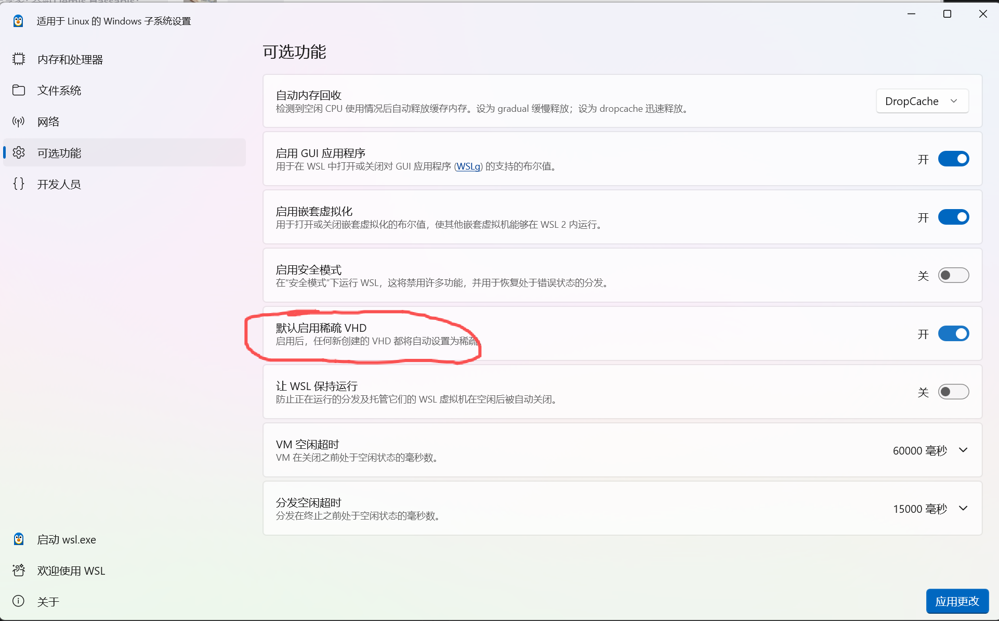

最近在 WSL2 中清理了一批文件后，发现 Ubuntu 内部的可用空间增加了，但 Windows 资源管理器中 C 盘的剩余空间并没有明显变化。

这并不是文件没有删除成功，而是 WSL2 的磁盘存储机制导致的。

## 一、为什么删除文件后，Windows 磁盘空间没有增加？

WSL2 会为每个 Linux 发行版创建一个虚拟硬盘（VHDX），用于存储 Linux 文件系统。以 Ubuntu 为例，对应的虚拟磁盘通常是 `ext4.vhdx`。

这个虚拟磁盘采用动态扩展的方式：随着 Linux 内部数据增加，VHDX 文件会逐渐变大；但当我们在 Linux 中删除文件时，释放的只是 ext4 文件系统内部的空间，Windows 上的 VHDX 文件通常不会自动缩小。

因此会出现下面这种情况：

- 在 Ubuntu 中执行 `df -h /`，可以看到可用空间已经增加；
- 但在 Windows 中查看 `ext4.vhdx`，文件仍然占据着原来的磁盘空间。

要把这部分空间真正还给 Windows，需要先让虚拟磁盘识别哪些数据块已经不再使用，再对 VHDX 文件进行压缩。

## 二、关于 Sparse VHD 设置

WSL 设置中有一个“默认启用稀疏 VHD”（Sparse VHD）的选项。开启后，后续新创建的 WSL 虚拟磁盘可以自动采用稀疏模式，在满足条件时将未使用的空间归还给 Windows。

<div align="center">
  
  <figcaption>WSL 设置中的“默认启用稀疏 VHD”选项</figcaption>
</div>

需要注意的是，这个全局设置主要影响之后新创建的虚拟磁盘。对于已经安装好的 WSL 发行版，仅仅打开这个开关，并不会自动把现有的 `ext4.vhdx` 转换为稀疏磁盘，也不会立即释放已经占用的空间。

本文采用手动压缩 VHDX 的方式处理已有发行版，不依赖 Sparse VHD 设置。

## 三、手动压缩 ext4.vhdx

下面以 `Ubuntu-20.04` 为例，介绍具体操作步骤。其他 WSL 发行版也可以使用相同的方法，只需要将发行版名称替换为自己的实际名称。

### 第一步：在 Ubuntu 中执行 fstrim

先进入需要处理的 Ubuntu 发行版，执行：

```bash
sudo fstrim -av
```

`fstrim` 会通知底层存储设备：Linux 文件系统中哪些数据块已经被释放、可以回收。完成后，退出 Ubuntu 终端即可。

也可以先通过下面的命令确认 Linux 文件系统内部的空间情况：

```bash
df -h /
```

### 第二步：查找 Ubuntu 虚拟磁盘路径

打开 Windows PowerShell，先确认发行版名称：

```powershell
wsl -l -v
```

确认名称为 `Ubuntu-20.04` 后，执行以下脚本查找对应的 `ext4.vhdx` 文件：

```powershell
$DistroName = "Ubuntu-20.04"

$DistroKey = Get-ChildItem -Path "HKCU:\Software\Microsoft\Windows\CurrentVersion\Lxss" |
    Where-Object { $_.GetValue("DistributionName") -eq $DistroName }

if (-not $DistroKey) {
    throw "找不到 WSL 发行版：$DistroName，请检查发行版名称。"
}

$BasePath = $DistroKey.GetValue("BasePath")
$Vhd = Join-Path -Path $BasePath -ChildPath "ext4.vhdx"

if (-not (Test-Path -LiteralPath $Vhd)) {
    throw "未找到虚拟磁盘文件：$Vhd"
}

$Vhd
```

命令会输出对应的虚拟磁盘完整路径，例如：

```text
C:\Users\xxx\AppData\Local\Packages\...\ext4.vhdx
```

如下图所示：

<div align="center">
  
  <figcaption>查询 Ubuntu 对应的 ext4.vhdx 路径</figcaption>
</div>

建议先记录一下该文件当前的大小，方便后续对比：

```powershell
Get-Item -LiteralPath $Vhd |
    Select-Object FullName, @{Name="Size(GB)"; Expression={[math]::Round($_.Length / 1GB, 2)}}
```

### 第三步：关闭 WSL 并压缩虚拟磁盘

接下来需要使用 Windows 自带的 DiskPart 工具压缩 VHDX。

**注意：这一步需要以管理员身份打开 PowerShell。** `wsl --shutdown` 会关闭所有正在运行的 WSL 发行版，而不只是 Ubuntu-20.04。请先保存 WSL 中正在进行的工作；如果正在使用 Docker Desktop，也需要留意它的 WSL 后端会随之停止。

首先执行：

```powershell
wsl --shutdown
```

可以通过下面的命令确认 WSL 发行版已经停止：

```powershell
wsl -l -v
```

确认状态均为 `Stopped` 后，启动 DiskPart：

```powershell
diskpart
```

进入 `DISKPART>` 提示符后，依次执行以下命令：

```text
select vdisk file="上一步输出的ext4.vhdx完整路径"
detail vdisk
compact vdisk
exit
```

其中：

- `select vdisk`：选择需要操作的虚拟磁盘；
- `detail vdisk`：查看当前选中的虚拟磁盘信息，建议确认路径无误后再继续；
- `compact vdisk`：压缩动态扩展的虚拟硬盘文件；
- `exit`：退出 DiskPart。

这里需要特别注意：执行 `wsl --shutdown` 是为了让 WSL 释放虚拟磁盘文件。根据 Microsoft 对 `compact vdisk` 的说明，动态扩展 VHD 必须处于已分离状态，或以只读方式附加，才能执行压缩操作。

### 第四步：检查压缩结果

DiskPart 执行完成后，回到 PowerShell，再次查看 VHDX 文件大小：

```powershell
Get-Item -LiteralPath $Vhd |
    Select-Object FullName, @{Name="Size(GB)"; Expression={[math]::Round($_.Length / 1GB, 2)}}
```

对比压缩前后的文件大小，就可以看到实际释放的空间。

<div align="center">
  <table style="border: none; background-color: transparent;">
    <tr align="center">
      <td style="width: 50%; border: none; padding: 0.01; background-color: transparent; vertical-align: middle;">
        
        压缩前
      </td>
      <td style="width: 50%; border: none; padding: 0.01; background-color: transparent; vertical-align: middle;">
        
        压缩后
      </td>
    </tr>
  </table>
  <figcaption>ext4.vhdx 压缩前后的磁盘占用对比</figcaption>
</div>

压缩完成后，可以重新启动 Ubuntu，正常使用 WSL。

需要说明的是，压缩 VHDX 释放的是 Windows 宿主机上的实际磁盘占用，并不会降低 Linux 所看到的虚拟磁盘最大容量。因此，重新进入 Ubuntu 后，`df -h /` 显示的文件系统总容量可能与压缩前相同，这是正常现象。

## 四、常见问题

### 1. 为什么执行 wsl --shutdown 后还需要 DiskPart？

`wsl --shutdown` 只是关闭 WSL 实例并释放虚拟磁盘文件，并不会主动压缩 VHDX。真正执行压缩的是 DiskPart 中的 `compact vdisk` 命令。

### 2. 为什么执行 compact vdisk 后，文件大小没有明显变化？

压缩效果取决于虚拟磁盘中有多少已经释放、且可以回收的空间。如果 Linux 内部仍然有大量数据，或者释放的数据块没有被底层虚拟磁盘识别，压缩后文件大小可能变化不大。

可以检查以下几点：

- 在 Ubuntu 中执行 `df -h /`，确认文件系统内部确实释放了空间；
- 在 Ubuntu 中执行 `sudo fstrim -av`；
- 确认已经执行 `wsl --shutdown`，并且没有其他进程继续占用该 VHDX；
- 确认 DiskPart 选中的是目标发行版对应的 `ext4.vhdx`。

### 3. 执行 wsl --shutdown 会影响其他 WSL 发行版吗？

会。该命令会停止所有正在运行的 WSL 发行版，而不只是当前需要压缩的 Ubuntu。因此，执行前请保存其他发行版中的工作，并注意 Docker Desktop 等依赖 WSL 的程序。

### 4. 可以直接删除 ext4.vhdx 吗？

不可以。`ext4.vhdx` 保存着整个 WSL 发行版的 Linux 文件系统，直接删除会导致对应发行版的数据丢失。需要释放空间时，应使用本文介绍的压缩方式，而不是手动删除虚拟磁盘文件。

## 五、参考资料

- [Microsoft Learn：如何管理 WSL 磁盘空间](https://learn.microsoft.com/zh-cn/windows/wsl/disk-space)
- [Microsoft Learn：compact vdisk 命令](https://learn.microsoft.com/zh-cn/windows-server/administration/windows-commands/compact-vdisk)
- [Microsoft Learn：WSL 高级设置配置（.wslconfig）](https://learn.microsoft.com/zh-cn/windows/wsl/wsl-config)
