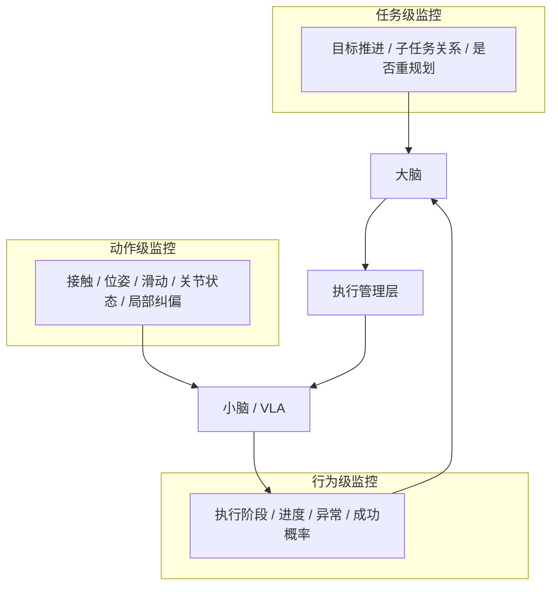
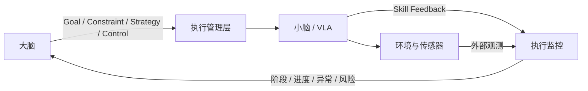

<!-- * 目录
{:toc} -->

> **NOTE：**
> 
> Created by GPT 6

# 1. 引言

近年来，Vision-Language-Action（VLA）模型推动了具身智能的发展。机器人接收自然语言指令，再根据视觉观测生成动作，已经能够完成抓取、分拣和桌面操作等任务。但当任务从单个动作扩展到持续数分钟、包含多个环节的家庭服务或业务流程时，问题就不只是“能不能生成动作”了。

以“把桌面上的杯子放进收纳柜”为例，机器人需要找到杯子、判断抓取方式、完成抓取和搬运，最后还要确认杯子是否放到了正确位置。过程中可能出现各种变化：第一次抓取没有成功，杯子在搬运时滑落，或者有人移动了杯子，导致原来的目标位置已经失效。机器人需要根据这些情况调整后续行为，而不是机械地重复原来的动作序列。

因此，长程任务需要的不只是任务分解和技能调用，还需要一个持续的反馈闭环：机器人要知道环境发生了什么，判断当前行为是否有效，并根据新的状态调整接下来的策略。

一种自然的系统设计是“大脑 + 小脑”：大脑负责任务理解、环境认知和策略决策；小脑负责具体技能的感知与动作执行。但这里有一个关键问题：**如果大脑只在技能开始前下达指令、技能结束后接收成功或失败状态，那么它更像一个任务调度器，而不是一个能够持续理解环境的具身智能体。**

本文想讨论的正是这个问题：大脑是否需要在小脑执行过程中持续感知环境？当感知与动作已经耦合在 VLA 中时，大脑如何建立自己的认知感知能力？大脑又应该监控哪些信息，并以什么形式、在什么时机干预小脑？

为此，本文选取 RoboMonitor、Hi Robot、τ₀-VLA、Inner Monologue 和 RT-H 五项工作进行梳理。它们分别从执行监控、分层策略、预测式决策、环境反馈和语言动作干预等角度切入。最后结合这些研究，讨论一套更适合长程任务的分层协同思路。

# 2. 相关工作调研

## RoboMonitor: Label-Efficient Runtime Monitoring of Robot Task Execution via Predictive Representation Learning

[RoboMonitor](https://arxiv.org/abs/2609.30715) 关注的是机器人执行过程中的运行时监控（Runtime Monitoring）：当机器人策略已经生成并执行动作后，系统如何判断机器人是否按预期推进、当前处于哪个执行阶段，以及任务是否真正完成？

这与动作生成是两个不同的问题。VLA 负责根据任务指令和视觉观测生成动作，但动作被发出并不意味着动作已经产生预期的物理结果。例如，机械臂执行了夹爪闭合动作，却没有真正抓住杯子；杯子在搬运过程中滑落；或者某个技能提前结束，但物体并没有到达目标位置。如果系统只在技能结束后接收一个简单的 `SUCCESS` 或 `FAILED` 标志，就很难准确掌握问题发生的时间和任务进度，也难以为上层决策提供足够的信息。

RoboMonitor 因此提出一个与底层动作策略解耦的视觉语言执行监控器。给定任务指令和执行过程中的多相机观测，它持续预测三个结果：

- **Execution Phase：** 当前处于哪个执行阶段，例如 Pick、Transport、Place。
- **Failure：** 当前是否出现执行失败，以及对应的失败概率。
- **Task Completion：** 整个任务是否已经完成，以及对应的完成概率。

它的定位不是替代 VLA 或低层控制器，而是提供一个独立的执行状态观察模块。部署时，RoboMonitor 只需要任务指令和相机观测，不需要访问底层控制器的内部状态、动作输出或策略模型的中间特征。因此，它既可以监控端到端视觉运动策略，也可以接入由上层编排器调用多个低层技能的机器人系统。

### 1. 整体架构：先学习执行表征，再训练监控能力

RoboMonitor 采用两阶段训练框架：

1. **Predictive Self-supervised Pre-training：** 利用已有的大规模机器人轨迹进行预测式自监督预训练。此阶段不需要执行阶段、失败或任务完成等监控标注，重点学习视觉表征以及视觉变化与机器人动作之间的时序关系。
2. **Causal Monitor Fine-tuning（Temporal SFT）：** 将预训练得到的视觉编码器和时序上下文编码器迁移到因果监控模型中，再使用少量带标注的执行轨迹，训练执行阶段识别、失败检测和任务完成判断。

这套设计针对的是机器人数据中的一个现实问题：策略训练阶段通常已经积累了大量同步的多相机图像、机器人状态和动作数据，但这些轨迹通常没有逐时刻的阶段、失败和任务完成标注。RoboMonitor 希望先利用无标注轨迹学习与执行相关的表示，再用较少的监控标注完成下游任务。

### 2. 第一阶段：Predictive Self-supervised Pre-training

预训练数据包含约 25 小时的多相机机器人轨迹，覆盖 12 种操作任务和两种机器人本体。数据包括同步 RGB 图像、机器人状态以及执行动作，但不包含执行阶段、失败和任务完成等监控标注。

作者以 Qwen3-VL-4B-Instruct 的视觉编码器作为初始化，并通过视觉 LoRA 进行适配，同时构建时序 Context Encoder，对相邻时刻的多视角视觉特征进行融合。预训练主要包含三个任务。

**（1）Action-conditioned Future-feature Prediction**

给定当前及历史时刻的多相机图像、机器人状态，以及随后执行的动作序列，Future Predictor 预测未来观测对应的视觉特征。

这里有一个重要区别：模型预测的不是未来 RGB 图像，而是由固定的目标视觉编码器提取的未来特征。整体思路与 JEPA（Joint-Embedding Predictive Architecture）一类的联合嵌入预测方法相近，目标是在特征空间学习环境随动作变化的规律，而不是逐像素重建图像。

其核心过程可以概括为：

- 输入当前和历史视觉观测，提取视觉上下文特征；
- 输入机器人当前状态以及后续执行的动作序列；
- 根据当前视觉上下文和动作信息，预测未来时刻的视觉特征；
- 将预测特征与真实未来观测经过冻结视觉编码器得到的特征进行对齐。

机器人状态和动作只输入 Future Predictor，不进入视觉编码器和 Context Encoder。这样，Context Encoder 学到的时序表示在部署时仍然可以仅由相机观测计算得到。

**（2）Inverse Dynamics**

前向预测根据状态和动作预测未来视觉特征；逆动力学则从两个时刻的视觉上下文摘要之差，预测这段时间内执行的动作。

它为视觉变化与机器人动作之间建立额外的学习约束，使上下文表示不仅包含场景外观信息，也能够反映与动作相关的变化。

例如，物体位置发生变化、机械臂发生位移、夹爪从张开变为闭合，这些视觉变化都应该能够与对应的机器人动作建立联系。

逆动力学分支是训练时的辅助任务，并不承担部署阶段的动作控制。

**（3）Masked-present Prediction**

作者在当前图像的视觉编码过程中遮挡连续的空间区域，再利用未遮挡区域的上下文预测被遮挡位置对应的视觉特征。

这一任务与 MAE 的思想有一定相似性，但这里预测的是固定视觉编码器输出的特征，而不是直接重建 RGB 像素。

三个任务分别从未来变化、动作关联和当前空间上下文三个角度训练视觉与时序表示。预训练结束后，保留适配后的视觉编码器和 Context Encoder；目标编码器、Future Predictor、逆动力学头和 Masked-present 解码器都不会用于最终部署。

### 3. 第二阶段：Causal Monitor Fine-tuning 与 Temporal SFT

第二阶段将预训练得到的表示迁移到因果执行监控模型中。模型以任务指令和连续多帧的多相机观测作为输入。论文采用 8 个时间步的因果观测窗口，每个时间步包含两到三个相机视角。

**（1）Causal Readout：在每个时间步读取监控状态**

作者在每个时间步的图像 Token 后插入一个专门的可学习 Readout Token（`<|state_reward|>`），并通过因果注意力限制该 Token 只能访问任务指令以及当前和之前的观测，不能看到未来帧。

因此，窗口中的每个时间步都可以产生一个只依赖历史信息的监控表示。

训练时，作者不再只监督窗口最后一个时间步，而是对窗口内多个时间步的 Readout 进行监督。其中最后一个时间步权重最高，较早时间步的预测则使用较小的上下文权重。由于失败样本相对较少，训练时还会对正向失败样本进行额外加权。

部署时则只使用最后一个时间步的预测结果。

**（2）融合预训练的时序上下文特征**

除了 VLM 对任务指令和观测历史的理解，模型还引入预训练得到的 Context Encoder，为每个时间步提供视觉时序特征，再通过 Residual Adapter 与 VLM 的 Readout 特征融合。

这里区分了两条特征融合路径：

- 执行阶段和任务完成预测共享一条融合特征分支；
- 失败检测则使用独立的融合分支。

最终分别通过三个预测头输出：

- Phase：通过 Softmax 预测当前执行阶段；
- Failure：通过 Sigmoid 输出失败概率；
- Completion：通过 Sigmoid 输出任务完成概率。

**（3）Temporal SFT：约束连续预测的一致性**

普通的逐帧监督能够让模型学习每个时刻的标签，但并不直接约束相邻时刻的预测是否稳定。

例如，机器人仍然处于抓取阶段，模型却可能在相邻观测之间反复输出 Pick、Transport、Pick。这种阶段抖动会给上层任务编排器带来不稳定的状态反馈。

为此，Temporal SFT 增加了两种时序一致性约束。

**Within-window Temporal Consistency**

在同一个观测窗口内，对相邻时间步的阶段概率分布施加平滑约束，抑制短暂、不合理的阶段跳变。

作者采用 MS-TCN 中的截断 Log-probability Smoothing Loss。截断机制可以避免对较大的预测变化持续施加越来越强的惩罚，从而保留真实阶段切换的可能性。

**Across-window Temporal Consistency**

对同一条轨迹中存在重叠时间戳的两个观测窗口，约束同一个时间戳得到的预测保持一致。

例如：

- 窗口 A：时间步 1～8；
- 窗口 B：时间步 3～10。

两个窗口都包含时间步 3～8。理论上，同一时刻的视觉观测不应该因为处于不同的窗口上下文，就产生明显不同的监控结果。

因此，作者对重叠时间段施加一致性约束：

- 对阶段概率分布，使用对称 KL 散度；
- 对失败概率，使用平方误差约束。

因此，第二阶段的训练不仅关注每个时间步是否预测正确，也关注同一段执行过程在不同窗口上下文下是否保持一致。

需要注意，论文中的 Temporal SFT 是密集时序监督与窗口内、窗口间一致性约束的组合，并不是简单地在推理阶段增加一个平滑滤波器。

### 4. 实验设置与结果

论文从标注效率、时序稳定性和闭环执行三个方面评估 RoboMonitor。

**（1）离线监控数据与任务**

监督微调覆盖四种操作任务：

- **Reel Packing：** 一只机械臂抓取 Reel 并交给另一只机械臂，再由后者放入收纳箱。
- **Electronic Component Insertion：** 抓取电子元件、搬运并插入测试模块。
- **Toolbox Sorting：** 在 Isaac Sim 中将螺丝刀、螺母、螺栓等物品分类放置。
- **Humanoid Grasping：** 人形机器人先推动收纳箱调整位置，再完成物体转移。

预训练语料中包含 Reel Packing 和 Electronic Component Insertion，但不包含 Toolbox Sorting 和 Humanoid Grasping。不过，这四项任务都参与了第二阶段的监督微调。因此，后两项任务只能说明它们未出现在自监督预训练语料中，不能将实验结果理解为完全零样本的监控泛化。

作者设置了 52 和 100 个带监控标注的 Episode 两种训练规模。52 个 Episode 的设置中，每项任务各有 13 个 Episode；测试集包含 66 个 Episode、7022 个观测窗口，每个观测窗口使用 8 个时间步的因果多相机观测。

**（2）离线监控性能**

下表列出主要结果。Phase Acc. 和 Macro Recall 衡量阶段识别；Completion AP 和 Failure AP 分别衡量任务完成与失败检测；Spurious Switch Rate 衡量真实阶段未改变时，模型却在相邻观测间切换阶段的比例，越低越好。

| 标注 Episode | 方法 | Phase Acc. | Macro Recall | Completion AP | Failure AP | Switch Rate |
|---:|---|---:|---:|---:|---:|---:|
| 52 | RoboMonitor | **93.09%** | **85.85%** | **87.60%** | 45.87% | 5.58% |
| 52 | Robometer + Temporal SFT | 88.77% | 81.78% | 85.42% | **59.39%** | 5.27% |
| 52 | Qwen3-VL + Temporal SFT | 86.76% | 74.23% | 74.01% | 46.37% | **4.95%** |
| 52 | Qwen3-VL + Pointwise SFT | 85.42% | 73.93% | 70.14% | 30.34% | 15.23% |
| 100 | RoboMonitor | **93.63%** | **88.55%** | **92.29%** | **72.01%** | **3.17%** |

从结果可以看到：

- 在 52 个标注 Episode 的条件下，RoboMonitor 的阶段准确率达到 93.09%，高于相同标注规模下的 Qwen3-VL 和 Robometer；其任务完成 AP 也达到 87.60%。与 100 个 Episode 训练的基线相比，RoboMonitor 使用 52 个 Episode 取得的阶段准确率仍然更高。
- 但低标注规模下的失败检测并没有同样明显的优势：RoboMonitor 的 Failure AP 为 45.87%，低于 Robometer 的 59.39%。因此，论文的低标注数据优势主要体现在阶段识别和任务完成判断上，不能据此认为少量标注已经足以可靠识别各种失败。
- 在 Qwen3-VL 的消融实验中，使用 Temporal SFT 后，Spurious Switch Rate 从 Pointwise SFT 的 15.23% 降至 4.95%，下降了 10.28 个百分点。同时，Failure AP 从 30.34% 提升到 46.37%。这说明窗口内密集监督和时序一致性训练的组合，能够明显改善连续预测的稳定性。
- 当标注规模增加到 100 个 Episode 时，RoboMonitor 的阶段准确率、Macro Recall、Completion AP 和 Failure AP 分别达到 93.63%、88.55%、92.29% 和 72.01%，失败检测性能也有明显提升。

**（3）闭环机器人实验**

作者进一步将 RoboMonitor 接入一个类似 GaP 的图结构任务编排器。编排器负责选择和调用低层技能，监控器根据执行过程中的预测结果跟踪任务进度，并在检测到失败时触发预先定义的恢复行为。

实验分别在 Isaac Sim 中的双臂 Toolbox Sorting 仿真任务，以及真实双臂 UR7e 工作站的 Reel Packing 任务中进行，每种设置各 40 次试验。

| 指标 | Reel Packing（真实机器人） | Toolbox Sorting（仿真） |
|---|---:|---:|
| 试验次数 | 40 | 40 |
| 失败事件 | 18 | 12 |
| 检测到的失败 | 15/18（83.3%） | 11/12（91.7%） |
| 误触发恢复 | 0 | 0 |
| 恢复成功 | 13/15（86.7%） | 11/11（100%） |
| 最终任务完成 | 35/40（87.5%） | 39/40（97.5%） |
| 单次观测窗口推理延迟 | 180–200 ms | 180–200 ms |

真实机器人实验中，18 次失败事件有 15 次被检测到，其中 13 次恢复成功，即 18 次失败中有 13 次被自主检测并恢复。两种设置均未观察到误触发恢复。

这部分实验的意义在于，RoboMonitor 不只是离线分类器，其输出确实被任务编排器用于跟踪进度和触发恢复。

但也要注意，恢复动作是编排器预先定义的，并不是 RoboMonitor 自己推理并生成的；每种设置只有 40 次试验，也不足以单独证明系统已经具备大规模部署所需的可靠性。

### 5. 局限性与思考

我认为 RoboMonitor 的工作定位比较明确，但距离一个完整的具身大脑仍有明显差距。

**第一，执行阶段表示仍然比较粗粒度。**

模型在每个时间步只输出一个全局执行阶段。对于双臂协作中的交接动作，这种表示可以工作；但如果两只机械臂同时执行不同技能，一个全局阶段就难以描述它们各自的状态。

作者也指出，未来可以将状态分解到不同机械臂、物体或并发技能，采用 Factorized 或 Multi-label Execution States。

**第二，能够检测失败，但还不能充分解释失败原因。**

当前输出主要是阶段类别、失败概率和任务完成概率，并不直接解释为什么抓取失败、物体是否滑落、发生了什么场景变化，也不会自主生成新的恢复策略。

论文将视觉语言解释作为后续方向，希望在失败分数之外，向规划器提供更具体的场景变化描述。

**第三，部署阶段仅使用视觉观测。**

机器人状态和动作只在预训练阶段使用，部署时监控器只接收任务指令和相机图像。

这种设计有利于与不同控制策略解耦，但对于遮挡、接触、滑动、碰撞等仅凭图像难以可靠判断的情况，单一视觉输入仍然存在局限。

对于真实具身系统，可以进一步考虑融合本体状态、力觉和技能执行状态；这属于后续扩展，并非论文已经实现的能力。

**第四，失败检测和不确定性仍需加强。**

52 个标注 Episode 时，Failure AP 只有 45.87%，说明失败检测对标注规模仍然比较敏感。

此外，论文虽然输出失败和完成概率，但没有进一步证明这些概率经过了可靠校准。作者提出未来可以使用 Conformal Prediction 等方法，为监控结果提供更可靠的不确定性估计，以决定何时请求额外观测或人工介入。

**第五，部署成本和实时性需要结合系统层级看待。**

论文的预训练使用 8 张 H100，监督微调用了 4 张 GPU，真实机器人部署则使用单张 NVIDIA RTX PRO 6000 Blackwell Max-Q，单个观测窗口的推理延迟约为 180–200 ms。

因此，它更适合作为大脑级的执行监控和状态评估模块，而不是替代小脑内部高频的视觉伺服、力控或安全控制。

### 6. 对大脑—小脑协同架构的启发

结合本文讨论的分层架构，我认为 RoboMonitor 最值得借鉴的不是某一个预测头，而是**将执行监控从动作策略中独立出来，让大脑能够根据真实环境观测判断小脑的执行结果**。

以“抓起杯子并放到指定位置”为例，可以形成如下闭环：

1. 大脑根据任务目标调用抓取技能，并向小脑下发目标和约束。
2. 小脑执行目标检测、位姿对齐、夹爪控制和抬升等具体动作，同时依靠技能级视觉、力觉和本体状态完成高频闭环。
3. 独立的执行监控模块持续观察机器人和环境，判断当前处于接近、抓取、抬升还是搬运阶段，并验证杯子是否真正随机械臂移动。
4. 如果监控结果显示抓取失败或杯子掉落，大脑结合当前环境状态决定重试、调整抓取方向、切换技能，或者重新规划任务。
5. 技能执行结束后，大脑再根据物体实际位置和任务完成条件确认结果，而不是仅依赖技能接口返回的 `SUCCESS`。

在这个架构中，几个模块的职责应当区分清楚：

- **Monitor：** 负责观察执行过程，输出阶段、异常、完成状态及其置信度。
- **Brain：** 负责结合任务目标和环境状态理解问题，决定继续执行、调整策略、切换技能或重新规划。
- **Skill / Cerebellum：** 负责具体动作执行，以及高频感知、运动控制和局部安全约束。

还需要注意不同模块的时间尺度。技能级感知与控制必须保持高频和低延迟；大脑级监控可以持续提供较轻量的状态判断，并在失败、停滞或环境突变时触发更深入的推理。

RoboMonitor 的 180–200 ms 推理延迟也说明，这类 VLM 监控不应被放进底层实时控制环路。

因此，我更倾向于把 RoboMonitor 看作大脑与小脑之间的一层**执行状态监控与反馈接口**，而不是直接把它等同于大脑。它回答的是“当前执行得怎么样”，而“为什么失败、接下来怎么办”仍应由大脑结合任务上下文和环境状态完成。

从这个角度看，未来值得进一步研究的是多模态、分层次的具身执行监控：技能级保留视觉、力觉和本体状态等高频反馈；大脑级融合场景变化、技能进度和异常事件；任务级评估整体目标是否达成。

通过这类分层反馈，大脑才能真正参与小脑的执行过程，而不只是被动地调用技能和接收最终结果。

论文：[arXiv:2609.30715](https://arxiv.org/abs/2609.30715) ｜ [HTML 全文](https://arxiv.org/html/2609.30715v1)

## Hi Robot: Open-Ended Instruction Following with Hierarchical Vision-Language-Action Models

[Hi Robot](https://arxiv.org/abs/2502.19417) 研究的是如何通过分层 VLA 完成开放式指令跟随。它将策略分成高层和低层：高层根据用户指令和当前视觉观测，生成下一步较具体的语言指令；低层则结合这些指令、视觉信息和机器人状态，生成实际动作。

例如，用户要求机器人整理餐桌，同时补充“只收走垃圾，不要动餐具”。机器人不仅要识别桌面上的物体，还要理解用户的限制，并在执行过程中根据新的观测或用户反馈调整下一步行为。高层策略负责理解任务和决定下一步做什么，低层策略则负责把这些要求转化为具体动作。

这项工作的一个重要特点是，高层并非只在任务开始时规划一次。它会根据新的视觉观测和用户交互重新生成低层指令；低层则以更高频率持续执行动作块。这样既避免了高层直接控制每个关节动作，也保留了执行过程中调整行为的能力。

不过，Hi Robot 主要解决的是高层如何理解复杂指令、组织低层行为，并根据反馈更新指令。它并没有单独构建一个通用的执行监控器，去持续验证低层动作是否真正成功。因此，它与 RoboMonitor 关注的是两个相邻的问题：前者强调高低层策略如何协同，后者强调如何独立判断执行过程是否正常。两者结合，才更接近完整的执行闭环。

论文：[arXiv](https://arxiv.org/abs/2502.19417) ｜ [PMLR](https://proceedings.mlr.press/v267/shi25d.html) ｜ [项目主页](https://www.pi.website/research/hirobot)

## τ₀-VLA: A Hierarchical Robot Foundation Model with World-Model-Guided Test-Time Computation

[τ₀-VLA](https://arxiv.org/abs/2608.16885) 进一步关注长程任务中的高层决策：机器人如何判断下一步应该做什么，以及在决策不确定时，能否比较不同方案可能带来的结果。

该方法采用高层策略与低层策略相结合的结构。高层根据任务指令、当前观测和执行记忆生成下一步子任务，低层则负责执行对应的动作块。与只生成一个子任务的方式不同，τ₀-VLA 引入了 World-Model-Guided Test-Time Computation：当高层需要进一步判断时，可以提出多个候选子任务，通过世界模型预测不同候选行为执行后的视觉结果，再由价值模型评估这些结果，最后选择更合适的子任务。

这使高层决策不再完全依赖一次语言推理。比如抓取杯子时，系统可以比较直接抓取、改变接近方向，或者先移开旁边物体等候选行为，再根据预测结果决定下一步。它体现的是一种预测式决策思路：不仅考虑当前应该做什么，也考虑不同选择可能造成什么后果。

这项工作对大脑设计的启发在于，大脑不应只在失败后被动调整；当状态不确定或存在多个可行方案时，也可以主动进行预测和比较。不过，τ₀-VLA 的重点是高层子任务生成和预测式推理，并不是持续运行的独立执行监控器。它并没有替代技能级实时感知，也不意味着底层动作执行可以脱离反馈闭环。

论文：[arXiv](https://arxiv.org/abs/2608.16885) ｜ [项目主页](https://tau0-vla.github.io/) ｜ [GitHub](https://github.com/sii-research/tau-0-vla)

## Inner Monologue: Embodied Reasoning through Planning with Language Models

[Inner Monologue](https://arxiv.org/abs/2207.05608) 是较早研究环境反馈如何重新进入机器人高层规划的工作之一。它讨论的问题很直接：如果语言模型只在任务开始时生成一份计划，机器人之后完全照着执行，那么中间某个动作一旦失败，后续计划就可能建立在已经过时的环境状态上。

作者提出将环境反馈持续加入语言模型的上下文，让模型根据已经发生的事情调整后续计划。论文讨论了几类反馈方式，包括被动场景描述、主动场景描述和成功检测。被动场景描述用于持续提供环境信息；主动场景描述则是在模型认为信息不足时，主动请求更详细的场景回答；成功检测用于判断上一步动作是否真正完成。

例如，机器人执行“把可乐放进抽屉”的任务。如果成功检测发现上一步没有完成，语言模型就可以根据失败信息重新规划，而不是继续执行原计划中的下一步。如果机器人无法确认某个物体是什么，也可以主动请求更详细的场景描述。

Inner Monologue 的核心价值，是把环境反馈重新引入规划过程。大脑不能只在任务开始时理解一次环境，而应该在执行过程中不断更新对环境的认识，并根据新的状态修正计划。

它的局限也比较清楚：反馈主要以语言描述和成功检测的形式进入高层推理，并不直接处理高频动作控制，也没有定义 VLA 技能的中断、暂停和接管协议。因此，它回答了“大脑如何根据环境变化重新规划”，但没有完整回答“大脑如何安全地干预正在执行的小脑”。

论文：[arXiv](https://arxiv.org/abs/2207.05608) ｜ [PMLR](https://proceedings.mlr.press/v205/huang23c.html) ｜ [项目主页](https://innermonologue.github.io/)

## RT-H: Action Hierarchies Using Language

[RT-H](https://arxiv.org/abs/2403.01823) 关注的是高层任务与底层动作之间的中间表示，以及如何利用它来干预动作策略。

传统的语言条件策略通常直接根据任务描述和视觉观测预测底层动作。例如，给出“关闭罐子”的指令，模型就直接生成机械臂动作。RT-H 则在任务和底层动作之间增加了一层 Language Motion，让模型先预测更细粒度的行为描述，例如“手臂向前移动”“向右调整”或“闭合夹爪”，再根据这些语言动作生成具体的机器人动作。

这种中间表示有两个作用。一方面，不同任务可能共享相似的动作结构，语言动作有助于复用这些行为；另一方面，它提供了一个比任务指令更具体、又不必深入到底层控制量的干预接口。如果当前行为方向不合适，可以将“手臂向前移动”修正为“手臂向左移动”，再由低层策略生成对应动作。

对大脑—小脑架构来说，RT-H 提醒我们：大脑传递给小脑的信息不应只有“抓杯子”这样的任务目标，也可以包括行为方向和局部约束，例如“从侧面接近”“降低手臂高度后再闭合夹爪”。当然，RT-H 中的干预主要由人提供，并不是一个根据自主监控结果自动触发的完整大脑—小脑闭环。

论文：[arXiv](https://arxiv.org/abs/2403.01823) ｜ [RSS 论文](https://roboticsproceedings.org/rss20/p049.pdf) ｜ [项目主页](https://rt-hierarchy.github.io/)

# 3. 分析与讨论

前面五篇论文分别从执行监控、分层协同、预测式高层决策、环境反馈重规划以及语言动作干预等角度切入。把这些工作放在一起看，我觉得最值得继续往下追问的，其实不是“高层和低层有没有分开”，而是一个更具体、也更难落地的问题：**大脑到底应该怎么监控小脑？对实时性的要求是什么？监控结果又该如何传递给小脑（VLA）？**

如果这三个问题说不清楚，那么“大脑 + 小脑”很容易退化成一句口号：大脑只负责拆任务，小脑负责执行动作，二者之间只有一次性调用关系。但真正的长程具身任务显然不是这样。抓杯子失败一次，大脑不应该只是等一个 `FAILED`；它更需要知道失败发生在什么阶段、是姿态问题还是目标变化、是否值得继续当前技能、是否需要换策略，甚至是否应该直接重规划。

因此，下面我想把讨论集中在三个问题上：

1. 大脑应该如何监控小脑；
2. 这种监控对实时性的要求是什么；
3. 大脑应以什么形式把监控和干预结果作用到小脑。

## 3.1 大脑应该如何监控小脑？

我觉得首先要避免两个极端。

- 一种做法是：大脑只在技能开始前发一次命令，等技能结束后再接收结果。这种方式太粗，大脑几乎看不到执行过程。
- 另一种做法是：大脑盯住小脑的每一步动作，甚至试图直接参与动作生成。这样又会让高层模型陷入低层控制回路，不仅计算开销大，也会破坏小脑本身的动作闭环。

更合理的方式，是把“监控”拆成不同层次来理解。

### 3.1.1 三层监控职责

| 监控层次 | 主要负责方 | 关注内容 | 典型问题 |
|---|---|---|---|
| 任务级监控 | 大脑 | 任务是否朝最终目标推进，子任务逻辑是否仍然成立 | 是否需要重规划？ |
| 行为级监控 | 大脑 + 执行管理层 | 当前技能是否按预期执行，是否出现偏离、停滞或异常 | 是否需要暂停、切换或调整策略？ |
| 动作级监控 | 小脑 | 接触、位姿、滑动、局部误差、关节状态 | 当前动作是否需要局部纠偏？ |

这里最重要的区别在于：**大脑监控的不是每一个动作做没做，而是当前行为是否仍然符合意图，以及是否需要改变执行策略。**

举个很直观的例子。抓杯子时，夹爪接近角度稍微偏了一点，这属于动作级问题，小脑自己调整就好；但如果杯子已经被人拿走了，原来的抓取目标不存在了，这就已经是行为级甚至任务级问题，必须通知大脑。

### 3.1.2 大脑应该看到什么信息？

如果大脑只收到一个 `SUCCESS / FAILED`，那么它对执行过程的理解几乎是空白的。更合理的方式，是维护一个统一的 **Execution Monitoring State**，让大脑持续获得对行为有判断价值的信息。

| 监控维度 | 具体内容 | 监控目的 |
|---|---|---|
| 行为状态 | 当前执行阶段、技能状态 | 知道 VLA 正在做什么 |
| 目标状态 | 杯子位置、姿态、是否可见 | 判断目标是否发生变化 |
| 执行进度 | 是否接近目标、是否完成接触 | 判断行为是否正常推进 |
| 执行质量 | 抓取稳定性、位置误差 | 判断执行效果 |
| 异常状态 | 抓取失败、物体滑落、碰撞 | 发现异常 |
| 不确定性 | 目标识别置信度、状态可信度 | 判断是否需要重新感知 |
| 任务影响 | 是否影响后续任务 | 判断是否需要重规划 |

在这些字段里，我觉得有两个尤其值得强调。

**第一，行为意图（Behavior Intent）。**

VLA 不应该只告诉大脑“我在运动”，而应该告诉它当前动作的目的。例如：正在接近杯子、正在调整抓取姿态、正在建立接触、正在抬起杯子、正在验证抓取是否稳定。这样，大脑理解到的就不是一串关节变化，而是一个有语义的执行过程。

**第二，执行预测（Execution Prediction）。**

例如，小脑可以给出一些自我评估：当前动作是否仍然可行、当前技能成功概率是否正在下降、是否建议调整抓取姿态、是否建议切换技能。当然，这类信息不能直接当成事实，它更像是小脑给大脑的“自我判断”，仍然需要结合外部感知和实际结果来验证。

### 3.1.3 监控关系示意

这个图想表达的其实很简单：动作级问题主要由小脑就地解决；行为级问题开始进入大脑的决策范围；任务级问题则直接影响后续规划。

## 3.2 对实时性的要求是什么？

“大脑要实时监控”这句话很容易说得很大，但如果不把“实时”拆开讨论，很容易落到两个误区：要么误以为大脑必须像底层控制器一样高频运行；要么又觉得大脑只要偶尔检查一下任务结果就够了。

我更认同的方式，是把系统中的时间尺度明确区分开来。

### 3.2.1 三种频率不要混在一起

至少要区分以下三类频率：

1. **传感器与状态更新频率**：视觉、触觉、本体状态的刷新速度；
2. **监控状态更新频率**：行为阶段、进度、异常检测等信息生成的频率；
3. **大脑推理频率**：高层真正进行一次复杂认知与策略决策的频率。

这三者不应该等同。

例如，相机可以持续更新目标状态，但并不意味着大脑每收到一帧图像就要做一次完整推理。真正需要的是：大脑始终掌握最新状态，但只在必要时投入高成本推理。

### 3.2.2 多时间尺度协同

下面这个表更接近我建议的原型设计目标。它不是统一标准，更像是一个工程上的初始预算。

| 层次 | 建议频率 | 主要职责 |
|---|---|---|
| 动作级闭环（Fast Loop） | 50–200 Hz | 视觉反馈、动作生成、手眼协调、局部纠偏 |
| 行为级监控（Medium Loop） | 5–20 Hz | 阶段识别、进度跟踪、异常检测、成功概率估计 |
| 大脑级推理（Slow / Event-driven） | 1–5 Hz | 环境理解、策略选择、技能切换、任务重规划 |
| 安全闭环（Safety Loop） | 100–1000 Hz | 急停、碰撞约束、力矩限制、危险区域监控 |

这里尤其要强调一点：**大脑级实时性，并不等于大脑要持续高频运行，而是指它在关键事件出现时要能足够及时地介入。**

### 3.2.3 事件驱动比固定高频推理更重要

如果进一步说得更直白一些，我觉得大脑更适合“持续感知 + 事件驱动推理”，而不是“固定频率的高成本推理”。

例如：

- 正常抓取时，大脑只接收状态摘要；
- 当抓取偏差增大时，行为级监控提高关注等级；
- 当连续几次接触失败时，触发大脑判断是否要换策略；
- 当杯子掉落或目标消失时，立即更新世界状态并重新规划；
- 当人突然进入危险区域时，先由安全系统接管，而不是等待大脑推理完成。

也就是说，真正需要“实时”的，是状态更新和异常发现；而大脑的复杂推理更像按需调度的计算资源。

## 3.3 大脑的监控结果应该以什么方式给到小脑（VLA）？

这是整个架构里最值得仔细设计的接口。

如果大脑只给小脑一句自然语言指令，例如“去抓那个杯子”，约束太弱；但如果大脑直接给出每一步控制量，又会破坏小脑自己的感知—动作闭环。比较合理的方式，是让大脑传递任务目标、执行约束和策略修正，而把高频动作细节留给小脑。

### 3.3.1 大脑向小脑传递四类信息

| 信息类型 | 作用 | 抓杯子示例 |
|---|---|---|
| Goal | 明确当前要完成什么 | 抓取桌面上的红色杯子，并放入收纳柜 |
| Constraint | 说明执行边界和条件 | 从侧面接近，避开旁边玻璃瓶，优先使用右手 |
| Strategy | 给出策略调整方向 | 放弃顶部抓取，改为侧面抓取；若仍失败，先移开障碍物 |
| Control Authority | 决定是否继续、暂停、中止、切换 | 继续执行 / 暂停 / 取消当前技能 / 切换技能 |

这里最需要区分的是 **Goal** 和 **Strategy**。

比如第一次抓取失败时，大脑不一定要立刻重做整个任务规划。更合理的做法是先判断：这究竟只是抓取方式需要调整，还是当前技能本身已经不适合。如果只是接近方向不对，那么给一个新的策略约束就够了；只有当原技能彻底不合适时，才需要切换技能，甚至任务重规划。

### 3.3.2 小脑向大脑反馈什么？

反过来，小脑也不能只给大脑回一个 `SUCCESS / FAILED`。更合理的是采用统一的 **Skill Feedback**。

| 反馈字段 | 示例 |
|---|---|
| Current Behavior | Approaching / Aligning / Grasping / Lifting |
| Execution Status | Running / Success / Failed |
| Progress | 当前阶段和进度 |
| Observed State | 杯子是否移动、是否接触 |
| Confidence | 当前状态的可信程度 |
| Failure Reason | 位置偏差、抓取滑动、目标丢失 |
| Recovery Suggestion | 调整姿态、更换抓取点 |
| Interruptibility | 当前是否可以安全暂停 |

这里我觉得最容易被忽视的是 **Interruptibility**。如果大脑在 VLA 正在抓取时发现目标已经变化，它不能直接覆盖当前动作输出，而应该先判断当前是否适合安全暂停，再通过执行管理层完成中止与切换。

### 3.3.3 三种干预等级

为了避免大脑频繁打断小脑，我更倾向于设计三级干预机制。

| 干预等级 | 作用方式 | 典型场景 |
|---|---|---|
| Level 1：参数级干预 | 不打断当前技能，只修改目标参数或执行约束 | 更新目标位姿、调整接近方向、缩小运动范围 |
| Level 2：技能级干预 | 暂停或终止当前技能，切换策略或切换技能 | 顶部抓取改为侧面抓取、改单手为双手、先清障再抓取 |
| Level 3：任务级干预 | 放弃当前任务路径，重新规划整个任务 | 目标消失、环境变化过大、任务条件失效 |

这个分层其实很重要。因为在实际系统里，并不是一出现问题就应该“重规划”。大多数情况下，更低代价的参数级调整就足够了；只有当当前技能已经不适用时，才升级到技能级或任务级干预。

### 3.3.4 一个更完整的通信闭环

这里的核心不是让大脑“接管动作”，而是让它基于监控信息，持续给出更合适的目标、约束和策略。小脑依然保留高频自主执行能力，大脑则负责在更高层次上维持整个行为的正确方向。

## 3.4 小结

如果把前面五篇论文和我们自己的讨论放在一起，我觉得最值得保留下来的结论有三点。

第一，**大脑必须监控小脑，但这种监控不应该下沉到每个动作细节**。更合理的方式是区分任务级、行为级和动作级，把动作级问题留给小脑，把行为级和任务级问题留给大脑与执行管理层。

第二，**大脑的实时性要求，本质上是“关键事件发生时能及时介入”，而不是持续高频运行**。持续更新状态、事件驱动推理、多时间尺度协同，比盲目提高高层推理频率更重要。

第三，**大脑与小脑之间需要明确的双向接口**。大脑给小脑的，不应只是自然语言任务描述，而应包含目标、约束、策略和控制权限；小脑回给大脑的，也不应只是成功与失败，而应包含阶段、进度、异常、不确定性和可中断性。

如果后续真的要落到系统实现，我认为最先值得定义清楚的，不是某个具体 VLA 模型，而是这一套 **Execution Monitoring State + Skill Feedback + 分级干预机制**。一旦这些接口清晰了，大脑与小脑的协同才会真正从概念图走向可运行系统。

## 具身智能分层感知—规划—执行架构示意

下面这张图总结了本文讨论的核心思路：技能级感知面向动作，大脑级与任务级感知面向认知；大脑不是一次性规划器，而是通过执行监控与小脑形成持续闭环。

  
  <figcaption>
    图：具身智能中的任务级 / 大脑级 / 技能级分层感知与协同闭环。
  </figcaption>

## 参考资料

1. [RoboMonitor: Label-Efficient Runtime Monitoring of Robot Task Execution via Predictive Representation Learning](https://arxiv.org/abs/2609.30715), 2026.
2. [Hi Robot: Open-Ended Instruction Following with Hierarchical Vision-Language-Action Models](https://arxiv.org/abs/2502.19417), ICML 2025.
3. [τ₀-VLA: A Hierarchical Robot Foundation Model with World-Model-Guided Test-Time Computation](https://arxiv.org/abs/2608.16885), 2026.
4. [Inner Monologue: Embodied Reasoning through Planning with Language Models](https://arxiv.org/abs/2207.05608), CoRL 2022.
5. [RT-H: Action Hierarchies Using Language](https://arxiv.org/abs/2403.01823), RSS 2024.